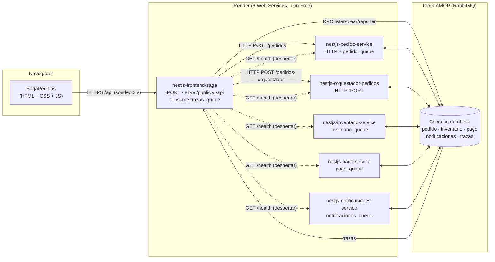
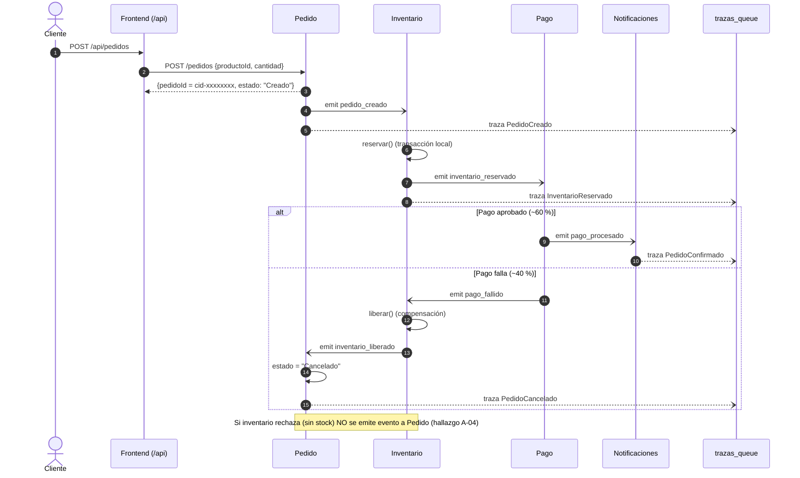
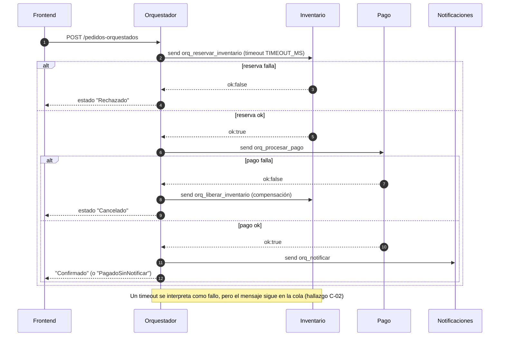
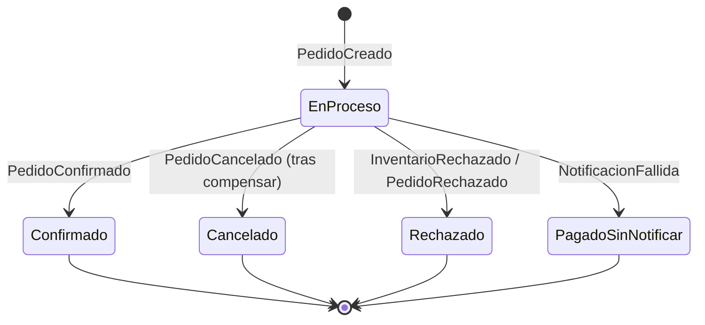
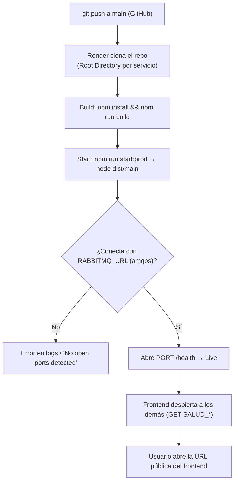

# AUDITORÍA TÉCNICA — SagaPedidos (Saga de Pedidos EDA con NestJS + RabbitMQ)

| | |
|---|---|
| **Alcance** | Los 6 proyectos del repositorio (`pedido`, `inventario`, `pago`, `notificaciones`, `orquestador`, `frontend`), `README.md` y `DESPLIEGUE.md` |
| **Tipo** | Auditoría estática y no destructiva. No se modificó ningún archivo de código ni de configuración; este informe es el único archivo nuevo |
| **Fecha** | 2026-10-25 |
| **Estándares de referencia** | WCAG 2.2 nivel AA, OWASP ASVS / Top 10, 12-Factor App, patrones Saga e idempotencia (Richardson, *Microservices Patterns*) |

## Cómo se hizo (y qué NO se hizo)

- **Revisión de código completa** de los 6 servicios, el HTML, el CSS y el JS del frontend.
- **Contraste de color calculado** con la fórmula de luminancia relativa de WCAG sobre los tokens de `styles.css`.
- **Medición responsive en navegador real** (Edge headless vía DevTools Protocol) cargando `public/index.html` desde un servidor estático temporal, en 320, 360, 390, 768 y 1280 px. Midió overflow horizontal y tamaño de objetivos táctiles. No tocó `data/` ni arrancó los servicios.
- **No se hizo:** ejecución de la Saga contra RabbitMQ, pruebas de carga, `npm audit`, Lighthouse/axe, prueba con lector de pantalla real, ni acceso a la URL desplegada en Render (no se conoce). Lo que dependa de esas pruebas está marcado como *"por verificar"*.

---

## 1. Resumen ejecutivo

**Qué es.** Un taller didáctico de integración: cuatro microservicios NestJS que cooperan solo por eventos en RabbitMQ (Saga *coreografiada*), una versión *orquestada* del mismo flujo con `send()` y un frontend (también NestJS) que sirve una página estática, expone una API `/api` y reconstruye el recorrido de cada pedido a partir de "trazas" publicadas en `trazas_queue`. Se despliega en Render (6 *Web Services* gratis) con RabbitMQ en CloudAMQP.

**Estado global: bueno para un taller, no apto para producción.** La idea central (Saga con compensación, `correlation_id`, trazabilidad desacoplada del negocio) está bien resuelta y bien explicada. Los problemas están en lo que un taller deja fuera a propósito: seguridad, entrega fiable de mensajes, idempotencia y manejo de tiempos de espera en la nube.

**Fortalezas**

- Compensación real y probada en ambos estilos; `liberar()` es idempotente (`inventario/app.controller.ts:68-75`).
- Trazas "fire-and-forget" dentro de `try/catch`: observar nunca rompe el negocio.
- Frontend sin `innerHTML`: todo se pinta con `textContent`/`createTextNode` → sin XSS por DOM. Las trazas que llegan de la cola se validan (regex de ID, `typeof`, `slice`) en `historial.ts:107-138`.
- Escritura atómica de JSON (archivo temporal + `renameSync`) y recuperación de archivo corrupto.
- Secretos por variable de entorno; `.env*` y `**/data/` en `.gitignore`; `DESPLIEGUE.md` advierte no publicar la AMQP URL.
- Accesibilidad base sólida: `lang="es"`, `aria-label` en entradas dinámicas, `aria-pressed`/`aria-expanded`, `:focus-visible` global, `prefers-reduced-motion`, **todos los pares de texto cumplen ≥ 4,5:1** (ver §3.2).
- Sin overflow horizontal a 360, 390, 768 y 1280 px.

**Debilidades principales**

1. **Cero autenticación** y servicios internos (Pedido, Orquestador) expuestos a internet por el despliegue.
2. **La Saga orquestada trata un *timeout* como fallo definitivo**, pero el mensaje sigue en la cola: con servicios que se duermen (Render gratis) produce reservas "fantasma" y cobros sin pedido.
3. **Entrega de mensajes frágil**: `noAck` por defecto, colas no durables, sin idempotencia en la reserva, sin DLQ ni *graceful shutdown*.
4. **Frontend rompe el foco y lo que el usuario escribe** cada vez que hay datos nuevos (re-render total cada 2 s) y **desborda 37 px a 320 px**.
5. **Consumo de cuota**: el sondeo cada 2 s genera ≈ 2,6 M de mensajes AMQP/mes por pestaña abierta, por encima del plan gratis.
6. **Cobertura de pruebas ≈ 0**: solo quedan las plantillas "Hello World" de Nest.

**Conteo de hallazgos:** 2 críticos · 7 altos · 11 medios · 8 bajos.

---

## 2. Hallazgos clasificados

Leyenda de categoría: **[SEG]** seguridad · **[LOG]** lógica de negocio · **[A11Y]** accesibilidad/UX · **[REND]** rendimiento/capacidad · **[OPS]** despliegue/resiliencia · **[CAL]** calidad/mantenibilidad.

| ID | Sev. | Cat. | Hallazgo |
|---|---|---|---|
| C-01 | Crítico | SEG | Sin autenticación/autorización; Pedido y Orquestador públicos |
| C-02 | Crítico | LOG | Timeout del orquestador = fallo definitivo, pero el mensaje sigue vivo en la cola |
| A-01 | Alto | A11Y | Overflow horizontal de 37 px a 320 px (WCAG 1.4.10) |
| A-02 | Alto | A11Y | Re-render total cada 2 s destruye foco y texto escrito; sin pausa del contenido que se actualiza (WCAG 2.2.2, 2.4.3) |
| A-03 | Alto | LOG/OPS | Reserva no idempotente; mensajería *at-most-once* sin ack/DLQ |
| A-04 | Alto | LOG | En coreografía el rechazo de inventario nunca llega a Pedido |
| A-05 | Alto | REND | Sondeo de 2 s agota la cuota de mensajes y las horas gratis |
| A-06 | Alto | LOG/OPS | Timeout del frontend (60 s) menor que el peor caso del orquestador (90 s); sin clave de idempotencia |
| A-07 | Alto | SEG | Sin cabeceras de seguridad, CSP, límite de peticiones; fuentes de terceros |
| M-01 | Medio | A11Y | Sin `<main>`, sin *skip link*, sin `aria-current` |
| M-02 | Medio | A11Y | Errores solo en un *toast* de 4,5 s con `role="status"` |
| M-03 | Medio | A11Y | Campos con contraste no textual 1,13:1; foco invisible en tarjeta oscura |
| M-04 | Medio | A11Y/UX | Estado de conexión oculto en móvil y no anunciado; estado de servicios "pegajoso" |
| M-05 | Medio | A11Y/UX | Sin indicador de carga en esperas de hasta 60 s |
| M-06 | Medio | OPS | 19 conexiones AMQP (5 al mismo `trazas_queue`); sin *shutdown hooks* |
| M-07 | Medio | OPS | `/health` no refleja caídas posteriores de RabbitMQ |
| M-08 | Medio | SEG/LOG | Sin DTO/`ValidationPipe`; coerción laxa con `Number()`; sin límite superior en Pedido/Orquestador |
| M-09 | Medio | CAL | Pruebas plantilla rotas/irrelevantes; lógica de negocio sin pruebas |
| M-10 | Medio | SEG | Fuga de detalles internos (mensajes de excepción, ruta de archivos) a la UI |
| M-11 | Medio | LOG/OPS | Persistencia en JSON local: disco efímero, escritura síncrona, `reservas` nunca se purgan |
| B-01 | Bajo | CAL | Código duplicado (`traza` ×6, `cliente` ×5, servidor de salud ×3) |
| B-02 | Bajo | A11Y | 13 objetivos táctiles < 44 px (cumplen el mínimo AA de 24 px) |
| B-03 | Bajo | A11Y | Estados que se distinguen solo por color/borde sutil |
| B-04 | Bajo | A11Y/SEO | Sin favicon, `meta description` ni `theme-color` |
| B-05 | Bajo | CAL | Documentación inconsistente (Node 18+ vs 24, versiones) |
| B-06 | Bajo | CAL | `Math.random()` fijo en el servicio de Pago |
| B-07 | Bajo | REND | Sin compresión ni `Cache-Control` explícito para estáticos |
| B-08 | Bajo | OPS | Sin IaC (`render.yaml`), sin Dockerfile, sin rollback documentado |

---

### C-01 · Sin autenticación ni autorización; servicios internos públicos — **Crítico [SEG]**

**Evidencia**

- `nestjs-frontend-saga/src/app.controller.ts:56-74` — `POST /api/productos` y `POST /api/productos/:id/reponer` cambian el inventario sin ninguna identidad.
- `nestjs-frontend-saga/src/app.controller.ts:135-139` — `POST /api/servicios/despertar` lanza peticiones salientes a 5 servicios por cada llamada anónima.
- `nestjs-pedido-service/src/main.ts:22-23` y `nestjs-orquestador-pedidos/src/main.ts:12-13` — ambos escuchan HTTP; en Render cada uno recibe URL pública. `POST /pedidos` y `POST /pedidos-orquestados` aceptan cualquier cuerpo `{productoId, cantidad}` entero.
- `DESPLIEGUE.md` ("Límites que debes conocer"): *"Cualquiera con el enlace puede usarlo. No hay inicio de sesión."*

**Impacto.** Cualquiera puede inflar el stock, vaciarlo con pedidos masivos, crear miles de productos (el JSON crece sin tope), o puentear las validaciones del frontend atacando Pedido/Orquestador directamente (el frontend limita `cantidad ≤ 1000`; ellos no).

**Recomendación**

1. Poner una autenticación mínima en el frontend/BFF (sesión o *API key* por cabecera) con un `Guard` de Nest, y exigirla en los endpoints que escriben.
2. Hacer que Pedido y Orquestador **no** sean públicos: en Render usar *Private Services* (red interna) y que solo el frontend los llame; o exigir un secreto compartido `X-Internal-Token` leído de una variable de entorno.
3. Añadir *rate limiting* (`@nestjs/throttler`).

**Por qué.** OWASP ASVS V4 (control de acceso) y Top 10 A01/A07: la autorización debe aplicarse en el servidor y en *cada* punto de entrada, no solo en el que usa la UI. Un servicio interno con puerto público es una puerta trasera de la que la UI es solo la fachada.

---

### C-02 · El orquestador trata el *timeout* como fallo definitivo, pero el mensaje sigue en la cola — **Crítico [LOG]**

**Evidencia** — `nestjs-orquestador-pedidos/src/app.controller.ts`

```ts
10  const TIEMPO_ESPERA_MS = Number(process.env.TIMEOUT_MS ?? 5000);
64      return await firstValueFrom(
65        client.send<Resultado>(patron, data).pipe(timeout(TIEMPO_ESPERA_MS)),
67    } catch (e) {
68      return { ok: false, error: ... };           // timeout == "falló"
115   if (!reserva.ok) { pedido.estado = 'Rechazado'; ... return pedido; }   // "no hay nada que compensar"
137   const liberar = await this.llamar(... 'orq_liberar_inventario' ...);
154   pedido.estado = 'Cancelado';                    // aunque `liberar.ok` sea false
```

**Escenario concreto (muy probable en Render gratis).** Inventario está dormido → `orq_reservar_inventario` queda **encolado** → a los 30 s el orquestador hace *timeout*, marca el pedido **Rechazado** y devuelve la respuesta → Inventario despierta, **consume el mensaje viejo y descuenta el stock**. Resultado: stock reservado para un pedido que el sistema dio por rechazado; como `reservas` nunca se limpia (M-11) y nadie la compensa, ese stock se pierde para siempre.
Lo mismo con `orq_procesar_pago`: *timeout* → el orquestador compensa el inventario, pero el pago puede completarse después → **cobro sin pedido**.
Además, si la compensación (`liberar`) misma falla por *timeout*, el pedido se marca `Cancelado` igualmente (línea 154) y el stock queda retenido sin reintento ni registro de pendiente.

**Recomendación**

1. Distinguir **"fallo de negocio"** (`ok:false` explícito del servicio) de **"resultado desconocido"** (timeout/transporte). Ante resultado desconocido nunca declarar el estado final: pasar a `Pendiente/EnReconciliación`.
2. Compensar siempre con operaciones **idempotentes** y **reintentadas** (con *backoff*) hasta confirmar; registrar el pedido como `CompensaciónPendiente` si no se logra.
3. Guardar el estado de la saga de forma durable (tabla/archivo `saga_log`) *antes* de cada paso, para poder reanudar o reconciliar tras una caída.
4. Enviar los mensajes `orq_*` con TTL (`expiration`/`x-message-ttl`) ≈ al timeout del orquestador, para que un mensaje vencido **no se procese tarde**.
5. En la reserva, usar la clave `correlationId` como llave de idempotencia (ver A-03) y una acción "cancelar reserva" tolerante a llegar *antes* que la reserva (*tombstone*).

**Por qué.** En sistemas distribuidos un *timeout* es un "no sé", no un "no". El patrón Saga exige compensaciones idempotentes y reintentables; sin ello, la consistencia eventual nunca converge.

---

### A-01 · Overflow horizontal a 320 px — **Alto [A11Y]** (WCAG 1.4.10 Reflow, AA)

**Evidencia (medida en Edge headless, viewport de 320 px):** `scrollWidth = 357 px` → **37 px de desbordamiento**. Elementos fuera del viewport: `.visual` (derecha = 357), `.hero-texto` (357), `.flujo-vidrio`, `.chips-top`.
Causa localizada: `.hero` pasa a `grid-template-columns: 1fr` (`styles.css:276`), y `1fr` equivale a `minmax(auto, 1fr)`; el contenido mínimo de la columna lo fija `.cifras` (`styles.css:138`, `repeat(3, 1fr)`, 289 px de contenido + 2×24 px de relleno = 337 px > 280 px disponibles).

| Ancho | scrollWidth | Overflow |
|---|---|---|
| 320 | 357 | **Sí (+37 px)** |
| 360 | 357 | No |
| 390 | 390 | No |
| 768 | 753 | No |
| 1280 | 1265 | No |

**Recomendación.** En `@media (max-width: 960px)`: `.hero { grid-template-columns: minmax(0, 1fr); }` y `.cifras { grid-template-columns: repeat(auto-fit, minmax(80px, 1fr)); }` (o `minmax(0,1fr)` con `overflow-wrap:anywhere` en las etiquetas). Aplicar `minmax(0, 1fr)` también a `.productos-layout`, `.tres` y `.campos`.
**Por qué.** WCAG 1.4.10 exige que el contenido se reconfigure sin scroll en dos dimensiones hasta 320 CSS px (equivalente a 400 % de zoom en escritorio). Los usuarios con baja visión que amplían el texto quedan afectados primero.

---

### A-02 · Re-render total cada 2 s: se pierde el foco y lo escrito; contenido en vivo sin pausa — **Alto [A11Y/UX]**

**Evidencia**

- `public/app.js:452-462` — `setInterval(..., 2000)` llama a `refrescar()`.
- `app.js:335-373` — cuando la "firma" JSON cambia, llama a `pintarProductos()`/`pintarPedidos()`.
- `app.js:167-173` y `264-267` — ambas hacen `replaceChildren()` y recrean **todos** los nodos, incluidos el `<input class="mini">` de "Reponer" y los botones "Ver recorrido".
- `index.html:130` y `:141` — `aria-live="polite"` sobre contenedores que se reemplazan por completo.

**Escenario.** Un usuario escribe "50" en "Cantidad a reponer"; llega una traza de otro pedido, la firma cambia y el campo se destruye: pierde el valor y el foco. Un usuario de teclado que está en "Ver recorrido" pierde su posición. Un lector de pantalla re-lee la lista entera en cada cambio. Los pedidos "En proceso" cambian durante varios segundos, así que ocurre justo cuando se está usando.

**Recomendación**

1. No reemplazar nodos: actualizar por *diff* con clave (`data-id`) o, como mínimo, **omitir el re-render si el foco está dentro del contenedor** (`container.contains(document.activeElement)`) y aplazarlo.
2. Quitar `aria-live` de las listas; anunciar solo un resumen puntual en un único `role="status"` ("Pedido cid-… ahora: Cancelado").
3. Ofrecer un control "Pausar actualización automática" (y sustituir el sondeo por **SSE/WebSocket**: el servidor ya recibe las trazas).

**Por qué.** WCAG 2.2.2 *Pausar, detener, ocultar* (A), 2.4.3 *Orden del foco* (A), 3.2.2/3.2.5 *Cambios inesperados*: el contenido que se actualiza solo y dura más de 5 s debe poder pausarse y no debe robar el foco.

---

### A-03 · Reserva no idempotente y mensajería sin garantías de entrega — **Alto [LOG/OPS]**

**Evidencia**

- `nestjs-inventario-service/src/app.controller.ts:49-65` — `reservar()` descuenta stock y escribe `datos.reservas[correlationId]` **sin comprobar si ya existía**. Si `pedido_creado` llega dos veces con el mismo `correlationId`, se descuenta dos veces y la segunda sobreescribe el registro: la compensación solo devuelve **una** unidad de reserva → stock perdido permanentemente.
- Todos los `app.module.ts` y `main.ts`: `queueOptions: { durable: false }`; no se configura `noAck` (en `@nestjs/microservices` RMQ el valor por defecto es `true`), ni `persistent`, ni *dead-letter exchange*, ni `prefetchCount`.
- Ningún `main.ts` llama a `app.enableShutdownHooks()`.
- Documentado como limitación: *"si RabbitMQ se reinicia, los mensajes pendientes se pierden"* (README), y *"si falla Notificaciones no hay compensación del pago"*.

**Consecuencias.** `noAck: true` ⇒ RabbitMQ borra el mensaje al entregarlo: si el proceso muere a mitad del *handler* (por ejemplo en un despliegue de Render, que envía SIGTERM) el evento se pierde y la Saga queda colgada. Es *at-most-once*; la ausencia de idempotencia impide pasar a *at-least-once* con seguridad.

**Recomendación**

1. Hacer `reservar()` idempotente: `if (datos.reservas[data.correlationId]) return { ok: true };`.
2. Usar `noAck: false` + `channel.ack/nack` (con `@Ctx() ctx: RmqContext`), `prefetchCount` y una cola de mensajes muertos (`x-dead-letter-exchange`) para mensajes "veneno".
3. En producción: `durable: true` y mensajes `persistent: true` (la guía del taller pide `false`; es una decisión consciente que debe revertirse al salir del taller).
4. `app.enableShutdownHooks()` para cerrar conexiones y terminar los *handlers* en curso.
5. Añadir el *inbox pattern* (tabla de `messageId` procesados) para dedup general.

**Por qué.** Los *brokers* ofrecen *at-least-once*; la corrección la da un consumidor idempotente (principio "exactly-once effects"). Sin ack manual no hay reintento posible.

---

### A-04 · En coreografía, Pedido nunca se entera del rechazo de inventario — **Alto [LOG]**

**Evidencia** — `inventario/app.controller.ts:98-112`: en la rama `else` de `reservarStock` solo se hace `console.log` y `this.traza('InventarioRechazado', …)`; **no se emite ningún evento** a `pedido_queue`. `PedidoService` conserva `estado: 'Creado'` para siempre (`pedido/app.controller.ts:49-50`; solo cambia en `inventario_liberado`).
El frontend "oculta" el problema deduciendo el estado desde las trazas (`historial.ts:141-148`), pero la fuente de verdad del servicio de Pedido es incorrecta; cualquier otro consumidor de Pedido vería un pedido "Creado" que nunca avanzará.

**Recomendación.** Emitir `inventario_rechazado` hacia Pedido y manejarlo con `@EventPattern` que ponga `Rechazado`. Añadir `GET /pedidos/:id` (hoy "no hay endpoint para consultar el estado", README) y un *timeout de saga* que marque `Expirado` los pedidos sin avance.
**Por qué.** En una Saga cada camino terminal (éxito, rechazo, compensación) debe llevar al agregado a un estado terminal explícito; deducirlo de logs/trazas no es un modelo de dominio.
**Relacionado.** `PEDIDOS` (`pedido:5`, `orquestador:12`) es un `Record` en memoria que **nunca se purga** → fuga de memoria lenta y pérdida total al reiniciar.

---

### A-05 · El sondeo de 2 s consume la cuota de mensajes y las horas gratis — **Alto [REND]**

**Evidencia**

- `app.js:452-462` + `app.js:336-340`: cada 2 s se hacen 3 peticiones; `GET /api/productos` (`app.controller.ts:51-54`) hace un RPC por RabbitMQ a Inventario (petición + respuesta = **2 mensajes AMQP**).
- Cálculo: 2 mensajes / 2 s = 1 msg/s ⇒ **86 400 al día ⇒ ≈ 2,6 M/mes por pestaña abierta 24/7**. `DESPLIEGUE.md` indica cuotas de 1 M (Little Lemur) y 2 M (Loyal Lemming) mensajes.
- `app.js:458` y `servicios.ts:33-42`: el "mantener despierto" cada 4 min sostiene 6 servicios; 6 × 744 h = 4 464 h frente a las 750 h/mes gratis compartidas (≈ 125 h por servicio ≈ 5 días de uso continuo).
- Cada `POST /api/pedidos` hace además otro `listar_productos` solo para obtener el nombre (`app.controller.ts:93-95`).

La pausa a los 20 min de inactividad mitiga el caso extremo, pero un presentador que interactúa de vez en cuando mantiene el sondeo activo.

**Recomendación.** (1) Cachear `productos` en el frontend con TTL (5–10 s) o mantenerlos actualizados por eventos; (2) cambiar el sondeo por **Server-Sent Events** alimentado por `recibirTraza`; (3) no consultar productos en `crearPedido` (el nombre puede venir del cliente y validarse luego); (4) sondeo adaptativo (2 s solo mientras haya pedidos "En proceso", 15–30 s en reposo).
**Por qué.** El costo de un sistema orientado a eventos debe escalar con los eventos de negocio, no con el reloj del navegador.

---

### A-06 · Desajuste de timeouts y falta de clave de idempotencia en el POST de pedido — **Alto [LOG/OPS]**

**Evidencia**

- `DESPLIEGUE.md`: orquestador con `TIMEOUT_MS=30000` ⇒ peor caso = 3 pasos × 30 s = **90 s** (o reservar + pago + liberar).
- `nestjs-frontend-saga/src/app.controller.ts:23,104`: `ESPERA_PEDIDO_MS = 60000` con `AbortSignal.timeout`.
- Resultado: a los 60 s el frontend responde **502 "No responde el Orquestador"** y **nunca llama a `registrarPedido`**, pero el orquestador sigue y el pedido existe (se verá luego como *"Pedido creado fuera de la interfaz"*, `app.js:236-238`). El usuario, creyendo que falló, reintenta ⇒ **pedido duplicado** (no hay `Idempotency-Key`).

**Recomendación.** (1) Regla de configuración: `TIMEOUT_PEDIDO_MS > n_pasos × TIMEOUT_MS + margen`. (2) Mejor: que el orquestador responda de inmediato `202 Accepted` con `pedidoId` y la UI siga el estado por trazas/SSE. (3) Generar un `Idempotency-Key` en el cliente y deduplicar en Pedido/Orquestador. (4) El frontend debería generar y registrar el `pedidoId` *antes* de llamar.
**Por qué.** Operaciones largas por HTTP síncrono sobre pasos con latencia variable producen estados ambiguos; la idempotencia hace seguro el reintento (RFC 9110 §9.2.2).

---

### A-07 · Sin cabeceras de seguridad, CSP ni límites; dependencia de terceros — **Alto [SEG]**

**Evidencia**

- `nestjs-frontend-saga/src/main.ts:9-17`: solo `useStaticAssets`; no hay `helmet`, ni `app.disable('x-powered-by')` (Express envía `X-Powered-By: Express`), ni `enableCors` explícito, ni compresión, ni `useBodyParser` con límite propio, ni *throttling*.
- Cabeceras ausentes (a verificar con `curl -I` en la URL real): `Content-Security-Policy`, `Strict-Transport-Security` (Render la sirve por HTTPS, pero la cabecera HSTS no la añade la app), `X-Content-Type-Options: nosniff`, `Referrer-Policy`, `Permissions-Policy`, `frame-ancestors`/`X-Frame-Options` (⇒ *clickjacking* posible: la página con botones de escritura puede incrustarse en un `<iframe>` ajeno).
- `index.html:7-9`: hoja de estilos de `fonts.googleapis.com` sin SRI ni política; envía la IP del visitante a un tercero (RGPD) y bloquea el renderizado.

**Recomendación.** `npm i helmet` y `app.use(helmet({ contentSecurityPolicy: { directives: { defaultSrc: ["'self'"], styleSrc: ["'self'", "https://fonts.googleapis.com"], fontSrc: ["https://fonts.gstatic.com"], frameAncestors: ["'none'"] } } }))`; **autoalojar** las fuentes Manrope/JetBrains Mono (elimina el tercero y permite `default-src 'self'`); `@nestjs/throttler`; `app.enableCors()` solo si hace falta, con lista blanca.
**Por qué.** Defensa en profundidad (OWASP Secure Headers Project): si algún día aparece un XSS o se incrusta la página, estas cabeceras limitan el daño. Hoy el XSS está bien evitado en el cliente; la CSP lo mantendrá así ante cambios futuros.

---

### M-01 · Estructura semántica: sin `<main>`, sin salto de bloques, sin `aria-current` — **Medio [A11Y]**

**Evidencia** — `index.html:12-180`: el contenido va en `<div class="contenedor">`; no existe `<main>`. No hay *skip link* "Saltar al contenido". Las `<section>` (`#pedido`, `#productos`, `#pedidos`, `#como-funciona`) no tienen `aria-labelledby`. El enlace activo de la barra solo cambia de clase (`app.js:433-435`), no se marca con `aria-current`.
Jerarquía de encabezados: `h1` (hero) → `h2` (Guía) → `h2` (Haz un pedido) → `h2` Productos → `h3` Nuevo producto → `h2` Pedidos → `h2` Cómo funciona → `h3`s ⇒ **correcta, sin saltos de nivel** (✔).

**Recomendación.** Envolver las secciones en `<main id="contenido">`; añadir `<a class="saltar" href="#contenido">Saltar al contenido</a>` visible al recibir foco; `aria-labelledby` en cada sección; `link.setAttribute('aria-current','location')` en el *observer*; `aria-label` único en los dos `<nav>`/regiones si se añaden más.
**Por qué.** WCAG 1.3.1 (Información y relaciones), 2.4.1 (Evitar bloques, A), 2.4.6/2.4.8.

---

### M-02 · Mensajes de error efímeros y mal anunciados — **Medio [A11Y]**

**Evidencia** — `app.js:108-115`: un único `#aviso` (`index.html:182`, `role="status" aria-live="polite" hidden`) muestra éxitos **y errores**, y desaparece a los 4,5 s. Se alterna el atributo `hidden` y el texto a la vez, combinación que varios lectores de pantalla no anuncian de forma fiable. Los campos inválidos no llevan `aria-invalid` ni `aria-describedby`; el mensaje del servidor (p. ej. "Ya existe un producto con ese nombre") no queda junto al campo.

**Recomendación.** Contenedor `role="alert"` (o `aria-live="assertive"`) presente siempre en el DOM y cuyo texto cambia; errores de formulario persistentes, junto al campo, con `aria-invalid="true"` y `aria-describedby`; no autodescartar los errores (o ofrecer botón "Cerrar" y pausar al hover/foco).
**Por qué.** WCAG 3.3.1 *Identificación de errores* (A), 3.3.3 *Sugerencias ante errores* (AA), 4.1.3 *Mensajes de estado* (AA), 2.2.1 *Tiempo ajustable*.

---

### M-03 · Contraste no textual y foco visible incompleto — **Medio [A11Y]**

**Evidencia** (cálculo WCAG propio sobre los tokens)

- `styles.css:151-155`: `input, select` tienen `background:#f2f1ee` sobre tarjeta blanca y `border:1px solid transparent` ⇒ **1,13:1** (mínimo 3:1, WCAG 1.4.11). Solo el `select` tiene un chevrón que ayuda.
- `styles.css:155`: `input:focus, select:focus { outline:none; … }` tiene mayor especificidad que `:focus-visible` (línea 38) ⇒ en campos el único indicador de foco es pasar el borde transparente a `#14100f` y el fondo a blanco (1 px). Existe, pero es débil (2.4.7 se cumple de forma mínima; 2.4.13 AAA no).
- `styles.css:38` `:focus-visible{outline:3px solid #14100f}` sobre `.tarjeta-oscura` (`#140c0c`, línea 127-129): el enlace "Pedidos" de la guía (`.pasos a`, línea 137) recibe un contorno **1:1 con su fondo ⇒ foco invisible** (2.4.7, A).

**Resultados de contraste de texto (todos ✔):**

| Par | Ratio |
|---|---|
| `--tinta-suave` #6a6560 / fondo #f2f2ef | 5,14 |
| `--tinta-suave` / píldora #e9e8e4 | 4,70 |
| `--tinta-suave` / insignia neutra #eceae5 | 4,79 |
| `--tinta-suave` / blanco | 5,76 |
| insignia ok / mal / aviso / info / raro | 5,57 · 5,56 · 4,97 · 5,81 · 6,78 |
| texto de `.cifras span` sobre tarjeta oscura | 8,66 |
| `.pasos` sobre tarjeta oscura | 12,67 |
| `.aviso.mal` (blanco / #8f2a20) | 8,33 |

**Recomendación.** Dar a los campos `border:1px solid #6a6560` (≥ 3:1 frente a blanco y a su fondo); en `input:focus-visible` conservar un `outline:3px solid` con `outline-offset:2px`; para superficies oscuras definir `:focus-visible` con `outline-color:#fff` (p. ej. `.tarjeta-oscura :focus-visible`, `.pausa :focus-visible`).
**Por qué.** WCAG 1.4.11 *Contraste no textual* (AA), 2.4.7 *Foco visible* (AA), 2.4.11 *Foco no oculto* (2.2 AA: verificar que la barra `sticky` — `top:10px; z-index:10` — no tape el elemento enfocado; `scroll-padding-top:96px` ayuda para anclas).

---

### M-04 · Estado de conexión y de servicios poco fiables — **Medio [A11Y/UX]**

**Evidencia**

- `styles.css:284`: en ≤ 960 px `.conexion { display:none }` ⇒ **en móvil el usuario no ve nunca "Sin conexión con el servidor"**. Además `#estadoConexion` (`index.html:26`) no tiene `aria-live`.
- `servicios.ts:36-40`: el estado `activo` se fija una sola vez en cada `despertarServicios()` (cada 4 min o con el botón); si un servicio vuelve a dormirse sigue mostrándose "Activo" hasta el siguiente sondeo. `app.js:285` muestra "Dormido o sin respuesta" sin distinguir causas.

**Recomendación.** Mantener la indicación de conexión en móvil (mover al pie o a la zona de avisos) con `role="status"`; refrescar el estado con un *health check* periódico ligero y mostrar la hora del último chequeo ("hace 2 min").

---

### M-05 · Sin indicador de carga en esperas largas — **Medio [A11Y/UX]**

**Evidencia** — `app.js:377-395`: al enviar un pedido el botón solo se deshabilita; su texto sigue siendo "Crear pedido" aunque la API pueda tardar hasta 60 s (servicio dormido). El formulario de producto (`app.js:397-411`) ni siquiera deshabilita el botón (doble envío posible).
**Recomendación.** Cambiar el texto a "Creando…", `aria-busy="true"` en el formulario, mensaje "Despertando servicios, puede tardar hasta 1 minuto" si hay servicios sin respuesta, y `AbortController` con botón Cancelar. **Por qué:** WCAG 3.3.x / heurística de Nielsen "visibilidad del estado del sistema".

---

### M-06 · Demasiadas conexiones AMQP y sin cierre ordenado — **Medio [OPS]**

**Evidencia** — cada `ClientsModule.register([...])` crea una conexión propia por cliente (`app.module.ts` de cada servicio): Pedido 2 clientes + 1 servidor, Inventario 3+1, Pago 3+1, Notificaciones 1+1, Orquestador 4, Frontend 1+1 ≈ **19** (`DESPLIEGUE.md`). Cinco servicios abren su **propia** conexión a `trazas_queue`. En Little Lemur (20 conexiones) queda 1 de margen; un despliegue *rolling* (instancia vieja + nueva solapadas) supera el tope ⇒ `connection refused`.
**Recomendación.** Extraer un módulo compartido `TrazasModule` con una sola conexión por proceso (y reutilizar el cliente en lugar de uno por destino cuando sea posible), usar un *topic exchange* para trazas, y `enableShutdownHooks()`. Reservar conexiones: plan con margen ≥ 2× el número de procesos.

---

### M-07 · `/health` no refleja la salud real — **Medio [OPS]**

**Evidencia** — `inventario|pago|notificaciones/src/main.ts:6-24`: `conectado` pasa a `true` tras `app.listen()` y **no vuelve a `false`** si la conexión AMQP se cae. En Pedido/Orquestador/Frontend (`main.ts` líneas 7-11/13-17) `/health` devuelve siempre `ok` sin consultar RabbitMQ. Tres implementaciones distintas del mismo endpoint.
**Recomendación.** Un único `HealthModule` (`@nestjs/terminus`) con indicador de RabbitMQ (estado de `amqp-connection-manager`), *liveness* vs *readiness* separados, y configurar `Health Check Path = /health` en Render para que reinicie instancias enfermas.

---

### M-08 · Validación de entrada informal — **Medio [SEG/LOG]**

**Evidencia**

- Ningún proyecto usa `ValidationPipe`/DTOs (`class-validator`); validación manual repetida (`pedido:38-46`, `orquestador:76-84`).
- `pedido`/`orquestador`: `cantidad` solo `≥ 1` (sin máximo); `productoId` sin mínimo ⇒ pueden llegar valores como `9007199254740991`.
- `frontend/app.controller.ts:80-82`: `Number(body.productoId)` coerciona `true`→1, `"2"`→2, `[2]`→2, `null`→0: acepta tipos que no son los esperados; en `reponer`, `Number(id)` de un parámetro no numérico da `NaN` (el mensaje final es engañoso: "El producto no existe").
- `inventario/app.controller.ts:194` valida `nombre`/`stock` (✔ bien), pero nada impide caracteres de control o nombres casi idénticos (Unicode).

**Recomendación.** DTOs con `@IsInt() @Min(1) @Max(1000)`, `app.useGlobalPipes(new ValidationPipe({ whitelist:true, forbidNonWhitelisted:true, transform:true }))`, `ParseIntPipe` en `:id`, y reutilizar las mismas reglas en los servicios (validar en *cada* frontera, no solo en la primera). **Por qué:** OWASP ASVS V5.

---

### M-09 · Pruebas inexistentes o rotas — **Medio [CAL]**

**Evidencia** — los `app.controller.spec.ts` y `test/app.e2e-spec.ts` de Pedido, Inventario, Pago y Notificaciones son la plantilla de Nest: esperan `appController.getHello()` → `'Hello World!'` y `GET /` → 200, pero esos controladores ya no tienen `getHello` ni ruta raíz ⇒ **fallan o no compilan**. `nestjs-orquestador-pedidos` y `nestjs-frontend-saga` no tienen ningún spec. Ninguna prueba cubre la compensación, `liberar()`, `estadoDe()` ni `registrarTraza()`. Lo "probado" en el README son ejecuciones manuales con logs.
**Recomendación.** Ver §4 (plan de pruebas). Prioridad: pruebas unitarias de `reservar/liberar/crearProducto/reponerStock`, `estadoDe`, `registrarTraza`, y una prueba de integración de la compensación con RabbitMQ en contenedor (Testcontainers).

---

### M-10 · Fuga de detalles internos — **Medio [SEG]**

**Evidencia**

- `orquestador/app.controller.ts:67-69`: `e.message` de excepciones de transporte se guarda como `error` y se envía en la traza `detalle` (hasta 200 caracteres) que el frontend publica en `/api/pedidos` y pinta en la UI (`app.js:216`).
- `index.html:117,175`: la interfaz revela `data/inventario.json` y `nestjs-frontend-saga/data/pedidos.json`.
- `pago/app.controller.ts:9`: el texto del error expone que es "simulado".
- Los logs del servidor imprimen el error de guardado completo (`almacen.ts:45`) — correcto en logs, pero hay que evitar que alcance al cliente.

**Recomendación.** Mapear errores a códigos/mensajes de dominio ("servicio no disponible") y dejar la excepción detallada solo en el log estructurado; quitar rutas de archivos de la interfaz. Crear un `ExceptionFilter` global que devuelva un cuerpo estándar (`application/problem+json`).

---

### M-11 · Persistencia en JSON local y estado en memoria — **Medio [LOG/OPS]**

**Evidencia**

- `almacen.ts:36-47` y `historial.ts:62-76`: `writeFileSync` **síncrono** tras *cada* operación (bloquea el *event loop*; en `historial` se reordena todo el mapa en cada traza). El `catch` solo hace `console.error`: si falla el guardado el servicio responde `ok:true` con estado distinto al del disco.
- `inventario/app.controller.ts:59`: `reservas[correlationId]` se crea siempre y **solo se borra al liberar**; los pedidos confirmados dejan su reserva para siempre ⇒ el JSON crece sin límite.
- `DESPLIEGUE.md`: en Render gratis el disco es efímero ⇒ `inventario.json` se reinicia con cada reposo/despliegue (productos creados por el usuario desaparecen; las `reservas` en curso también, rompiendo compensaciones pendientes).
- No escala horizontalmente: dos instancias de Inventario tendrían stocks distintos (estado en memoria + archivo local).

**Recomendación.** Base de datos real (PostgreSQL, que Render ofrece gratis para pruebas) con transacción `UPDATE productos SET stock = stock - $1 WHERE id=$2 AND stock >= $1` (reserva atómica) y tabla `reservas(correlation_id PK)`; marcar la reserva `confirmada` en lugar de borrarla; purgar por antigüedad. Si se mantiene el JSON: `fs.promises` con una cola de escrituras y *debounce*.
**Por qué.** La decisión "una BD por servicio + transacción local" es la base del patrón Saga; el JSON cumple lo didáctico pero no ofrece atomicidad ni concurrencia entre procesos.

---

### Hallazgos bajos (resumen con evidencia)

| ID | Evidencia | Corrección |
|---|---|---|
| B-01 | Función `traza()` copiada en 6 controladores (`pedido:16`, `inventario:28`, `pago:22`, `notificaciones:16`, `orquestador:36`); factoría `cliente()` en 5 `app.module.ts`; servidor HTTP de salud triplicado | Paquete/lib compartida (`@saga/comun`) o módulo Nest `TrazasModule` + `HealthModule` |
| B-02 | Medición real: 13 controles de < 44 px de alto (`.pill` 41 px, `.btn-chico` ≈ 37 px, `.filtro` ≈ 36 px, `.mini`). Ninguno < 24 px salvo un elemento sin id (a revisar con herramientas de desarrollo) | WCAG 2.5.8 (AA, ≥ 24 px) se cumple; subir a ≥ 44 px en móvil (2.5.5 AAA, guías de Apple/Google) con `@media (pointer: coarse)` |
| B-03 | `.filtro.on` y `.pill.activo` se distinguen por un cambio de borde/color sutil (`styles.css:60,207`); el punto de cada paso (`.paso-punto`) cambia solo de color (verde/naranja/rojo) | WCAG 1.4.1: añadir un indicador no cromático (negrita, ✓, texto "error" visible) |
| B-04 | `index.html`: sin `<link rel="icon">` (⇒ 404 en `/favicon.ico`), sin `<meta name="description">` ni `theme-color` | Añadirlos |
| B-05 | `README.md` pide "Node.js 18 o superior" mientras `DESPLIEGUE.md` fija `NODE_VERSION=24` y `@types/node ^24`; no hay campo `engines` | Declarar `"engines": {"node": ">=24"}` y alinear la documentación |
| B-06 | `pago/app.controller.ts:50,88`: `Math.random() > 0.4` fijo | Leer la probabilidad de `PAGO_FALLA_PROB` (por defecto 0,4) para poder probar de forma determinista |
| B-07 | `useStaticAssets` sin `maxAge`; sin `compression()` | Habilitar compresión y `Cache-Control` con *hash* de versión en JS/CSS |
| B-08 | No hay `render.yaml`, ni Dockerfile, ni procedimiento de *rollback* | Definir infraestructura como código (Blueprint de Render) y un `Dockerfile` multi-etapa con usuario no root |

**Objetos no aplicables / sin hallazgo:** *textos alternativos* — la página no contiene ``; los adornos son CSS o llevan `aria-hidden="true"` (✔). *Errores de JavaScript en cliente* — el código usa `try/catch` en cada llamada asíncrona, `Promise.allSettled` y `'use strict'`; no se detectaron excepciones no controladas por lectura (un `window.onerror` o `unhandledrejection` que muestre aviso sería un refuerzo opcional).

---

## 3. Recomendaciones — priorización sugerida

| Orden | Acción | Hallazgos que cierra | Esfuerzo |
|---|---|---|---|
| 1 | `minmax(0,1fr)` en rejillas y `.cifras` fluido | A-01 | 15 min |
| 2 | Reservar idempotente (1 línea) y `enableShutdownHooks()` | A-03 (parte) | 15 min |
| 3 | Distinguir timeout de fallo, TTL de mensajes `orq_*`, reintento de compensación | C-02 | 1-2 días |
| 4 | Evitar re-render con foco dentro; quitar `aria-live` de listas; botón Pausar | A-02 | 3 h |
| 5 | Token interno entre servicios + auth en `/api` + `helmet` + throttler | C-01, A-07 | 1 día |
| 6 | Emitir `inventario_rechazado` y endpoint `GET /pedidos/:id` | A-04 | 3 h |
| 7 | Cache de productos y SSE en lugar de sondeo; alinear timeouts | A-05, A-06 | 1 día |
| 8 | Landmarks, errores accesibles, contraste de campos, foco en superficies oscuras | M-01…M-05 | 3 h |
| 9 | Base de datos real + ack manual + colas durables | A-03, M-11 | 2-3 días |
| 10 | Pruebas (ver §4) | M-09 | continuo |

---

## 4. Pruebas y validaciones que se deben repetir tras las correcciones

### 4.1 Unitarias (Vitest, ya configurado)

| Objetivo | Casos mínimos |
|---|---|
| `InventarioService.reservar` | éxito; stock insuficiente; producto inexistente; cantidad 0/negativa/decimal; **mismo `correlationId` dos veces ⇒ un solo descuento** |
| `InventarioService.liberar` | libera una vez; **segunda llamada no suma stock**; `correlationId` desconocido |
| `crearProducto` / `reponerStock` | nombre vacío/61 caracteres/duplicado (mayúsculas distintas); stock −1, 1.5, 100001 |
| `historial.estadoDe` | todas las combinaciones: Cancelado > Rechazado > Pagado sin notificar > Confirmado > En proceso |
| `historial.registrarTraza` | ID inválido, campos que no son `string`, truncado de longitudes, traza duplicada |
| Orquestador | pago `ok:false` ⇒ compensa y `Cancelado`; **timeout en reserva ⇒ estado `Pendiente` (no `Rechazado`)**; compensación fallida ⇒ `CompensaciónPendiente` |
| `Pago` | con `PAGO_FALLA_PROB=0` y `=1` el resultado es determinista |

### 4.2 Integración (RabbitMQ real en contenedor / Testcontainers)

- Camino feliz, fallo de pago y rechazo de inventario, en **ambos modos**; verificar estado final en Pedido, stock en Inventario y traza completa por `correlation_id`.
- **Caída de un consumidor**: detener Inventario, publicar `pedido_creado`, reiniciar y comprobar que se procesa una sola vez (ack manual + idempotencia).
- **Reinicio de RabbitMQ** con colas durables: no se pierden eventos.
- **Mensaje duplicado** y **mensaje malformado** ⇒ van a la DLQ, el consumidor no se cae.
- **Timeout del orquestador** con consumidor lento: sin reservas fantasma ni cobros huérfanos tras la reconciliación.
- Contrato HTTP (supertest): `POST /api/pedidos` con cuerpos inválidos (strings, `null`, arreglos, números enormes) ⇒ 400; sin credenciales ⇒ 401/403.

### 4.3 Seguridad

- `curl -I https://<frontend>/` y comprobar `Content-Security-Policy`, `Strict-Transport-Security`, `X-Content-Type-Options`, `Referrer-Policy`, `frame-ancestors`; ausencia de `X-Powered-By`. Escaneo con [securityheaders.com] / ZAP baseline.
- Acceso directo a `https://<pedido>/pedidos` y `https://<orquestador>/pedidos-orquestados` **sin token** ⇒ debe fallar.
- `npm audit --omit=dev` en los 6 proyectos (no ejecutado en esta auditoría) y revisión de `package-lock.json`.
- Revisar que la `RABBITMQ_URL` no aparezca en logs, respuestas ni en el historial de Git (`git log -S amqps://`).

### 4.4 Accesibilidad

- **Automática:** axe DevTools / Lighthouse (accesibilidad ≥ 95) y `pa11y` en CI, en los 4 anchos.
- **Teclado:** recorrer toda la página solo con Tab/Shift+Tab/Enter/Espacio; foco visible siempre (incluida la tarjeta oscura y la ventana de "Reanudar"); el foco **no se pierde** al llegar una traza (A-02); ninguna trampa de foco.
- **Lector de pantalla:** NVDA + Firefox y VoiceOver + Safari: anuncio de errores, de cambios de estado y de la lista de pedidos sin lecturas repetidas.
- **Zoom/Reflow:** 400 % a 1280 px y 320 px sin scroll horizontal (repetir la medición de A-01; criterio `scrollWidth ≤ innerWidth`).
- **Contraste:** recalcular tokens nuevos (≥ 4,5:1 texto, ≥ 3:1 componentes y foco); probar modo de alto contraste de Windows (`forced-colors`).
- **Táctil:** objetivos ≥ 24 px (AA) y, en `pointer: coarse`, ≥ 44 px.

### 4.5 Responsive (re-ejecutar en 320, 360, 390, 768, 1024 y 1440 px)

Sin overflow horizontal, barra de navegación utilizable (los pills se desplazan dentro de su contenedor), formularios en una columna ≤ 640 px, `.pedido-cabecera` sin recortes, *toast* dentro del viewport.

### 4.6 Carga y resiliencia

- **k6/Artillery:** 20 usuarios virtuales durante 5 min contra `/api/pedidos` en cada modo; medir p95, tasa de error, mensajes AMQP/s y memoria de los procesos (detectar el crecimiento de `PEDIDOS` y de `reservas`).
- **Prueba de la cuota:** contar mensajes publicados por una pestaña abierta 10 min antes/después del cambio a SSE/caché (objetivo: < 1 % del valor actual).
- **Caos básico:** matar un servicio durante un pedido, bloquear RabbitMQ 30 s, enviar SIGTERM durante un *handler* (con `enableShutdownHooks` el mensaje debe terminar o reencolarse).
- **Arranque en frío en Render:** medir el tiempo de despertar y confirmar que la UI informa "Despertando…" y no devuelve 502 falsos (A-06).

---

## 5. Explicación del despliegue y del diseño

### 5.1 Arquitectura general



**Por qué esta forma.**
- **Un servicio = una responsabilidad** (Pedido, Inventario, Pago, Notificaciones): alta cohesión, y el acoplamiento se reduce a *nombres de cola y de evento* (contratos), no a URLs.
- **El navegador nunca habla con RabbitMQ** (`app.js` comentario inicial): el frontend NestJS actúa como BFF, así las credenciales AMQP no salen del servidor.
- **Las trazas van por una cola aparte (`trazas_queue`)** y el frontend las consume: observar no bloquea ni puede romper el negocio (cada `traza()` está en `try/catch`).
- **Render exige un puerto HTTP**; por eso Inventario, Pago y Notificaciones (que solo consumen colas) abren un servidor mínimo `/health` únicamente si existe `PORT` (`main.ts`). En local no abren nada.
- **Variables de entorno** (`RABBITMQ_URL`, `PORT`, `TIMEOUT_*`, `SALUD_*`) separan configuración de código (12-Factor III); el valor por defecto `amqp://localhost:5672` permite correr sin configurar nada.

### 5.2 Saga coreografiada (eventos) — camino feliz y compensación



### 5.3 Saga orquestada (request-response)



### 5.4 Máquina de estados del pedido (deducida por el frontend)


Prioridad de evaluación en `historial.estadoDe`: Cancelado → Rechazado → Pagado sin notificar → Confirmado → En proceso.

### 5.5 Flujo de despliegue en internet



**Decisiones de despliegue y su justificación**

| Decisión | Motivo | Costo / riesgo asociado |
|---|---|---|
| RabbitMQ gestionado (CloudAMQP, plan gratis) | No se puede alojar un *broker* con estado en Render gratis; el broker gestionado ofrece TLS (`amqps://`) | Límite de conexiones (20) y de mensajes (1–2 M/mes) → M-06, A-05 |
| 6 *Web Services* separados, un repo, `Root Directory` por carpeta | Despliegue y escalado independientes, reflejan el diseño de microservicios | Cada uno se duerme a los 15 min; 6 × 744 h > 750 h gratis |
| `NODE_VERSION=24`, build `npm install && npm run build`, start `start:prod` | Reproducible; compila TypeScript en la nube | Sin lockfile estricto (`npm ci` sería más determinista), sin Docker |
| Servidor `/health` mínimo en consumidores puros | Render requiere puerto abierto y sirve para despertarlos | No refleja salud real de AMQP → M-07 |
| Frontend despierta y vigila servicios (`SALUD_*`, cada 4 min, pausa a 20 min) | Mitigar el arranque en frío del plan gratis | Consume horas/mensajes; estado obsoleto → A-05, M-04 |
| Colas `durable:false` | La guía del taller lo exige; simplifica el taller | Se pierden mensajes si el broker reinicia → A-03 |
| Datos en JSON | Persistencia sin BD para el taller | Disco efímero en la nube → M-11 |
| `TIMEOUT_MS=30000` (orquestador), `TIMEOUT_INVENTARIO_MS=30000` (frontend) | Tolerar los ~60 s de despertar | Desajuste con los 60 s del frontend → A-06 |
| Secreto (`RABBITMQ_URL`) solo en variables de Render | No va a Git ni a la documentación | ✔ buena práctica; falta rotación documentada |

### 5.6 Respuestas a las preguntas clave del taller

**1. ¿Por qué una Saga y no una transacción distribuida (2PC)?** Cada servicio es dueño de sus datos y no comparten base. 2PC bloquearía recursos y no funciona bien entre servicios que pueden estar dormidos. La Saga divide el proceso en **transacciones locales** y define **acciones compensatorias** (aquí: `liberar()` stock) para deshacer lo ya hecho, aceptando **consistencia eventual**. Por eso un pedido pasa por "En proceso" antes de llegar a un estado final.

**2. ¿Dónde está la compensación en cada estilo?**
- *Coreografiada:* repartida en tres proyectos — Pago emite `pago_fallido` (`pago/app.controller.ts:80`), Inventario lo recibe y devuelve el stock (`revertirReserva`, `inventario:115-135`), Pedido marca `Cancelado` (`cancelarPedido`, `pedido:76-94`).
- *Orquestada:* concentrada en un `if (!pago.ok)` de `crearPedidoOrquestado` (`orquestador:135-162`), que ordena `orq_liberar_inventario`.

**3. ¿Qué diferencia hay entre `emit()` y `send()`?** `emit()` publica un evento y sigue (el emisor no sabe quién ni cuándo lo procesa; mensaje asíncrono). `send()` abre una petición con respuesta (`replyTo`) y el emisor **espera** (con `timeout`). Eso explica por qué `POST /pedidos` devuelve `"Creado"` al instante y `POST /pedidos-orquestados` devuelve el estado final.

**4. ¿Cuál es más simple y cuál más robusta?** Coreografiada: servicios más simples y desacoplados, pero el flujo completo no está en ningún sitio (hay que seguir el `correlation_id`). Orquestada: el flujo se lee de arriba abajo y es más fácil de auditar y de poner reintentos/*timeouts*, a costa de un punto central que conoce a todos y cuya caída detiene los pedidos orquestados. Con la implementación actual, **ninguna** es todavía robusta ante fallos parciales (A-03, C-02); el orquestador la haría más fácilmente con un registro de saga durable.

**5. ¿Qué pasa si un servicio está caído?** Coreografiada: el evento queda en la cola hasta que vuelva (si la cola/broker sobreviven y el consumidor usa ack manual). Orquestada: el `timeout` convierte la ausencia en un paso fallido y dispara compensación — con el riesgo de que el mensaje se procese tarde (C-02).

**6. ¿Para qué sirve el `correlation_id`?** Es un identificador (`cid-` + 8 hex) generado una sola vez en el origen (Pedido u Orquestador) y copiado en cada log y evento, de modo que se reconstruya el recorrido completo, incluida la compensación. Es la base de la trazabilidad que el frontend muestra.

**7. ¿Cómo se añade el paso "generar factura"?**
- *Orquestada:* servicio nuevo con `@MessagePattern('orq_generar_factura')`, registrar su cliente en `app.module.ts` del orquestador y añadir un bloque entre pago y notificación; si falla, compensar en orden inverso (reembolsar pago — método que hoy no existe — y liberar inventario). Cambian: orquestador, Pago, servicio nuevo.
- *Coreografiada:* Pago hoy emite directo a `notificaciones_queue` (punto a punto), así que hay que modificarlo para alimentar a Facturación y que esta emita `factura_generada` hacia Notificaciones; la compensación añade eslabones (fallo de factura → reembolso en Pago → liberar en Inventario → cancelar en Pedido). Cambian tres proyectos existentes + el nuevo.
- *Mejora de diseño:* publicar eventos en un **exchange tipo topic/fanout** (pub/sub) en lugar de emitir a la cola de un único destinatario. Así Facturación se suscribe sin modificar a quien emite.

**8. ¿Por qué el frontend no habla con RabbitMQ?** Las credenciales y el protocolo AMQP no deben exponerse al navegador; además centralizar el acceso permite validar, limitar y auditar. El frontend es un *Backend-for-Frontend* que traduce HTTP ↔ mensajes.

**9. ¿Por qué un JSON y no una base de datos?** Es una decisión didáctica (menos piezas, inspeccionable a mano). Cumple "estado persistente por servicio" pero sin transacciones ni concurrencia entre instancias; en la nube el disco es efímero. En producción debe ser una BD por servicio.

**10. ¿Qué garantías ofrece el sistema hoy?** Compensación correcta en el camino lógico sin fallos de infraestructura; trazabilidad por pedido; resiliencia *best-effort* al sueño de los servicios. **No** ofrece: entrega garantizada, idempotencia, consistencia ante timeouts, ni seguridad de acceso. Las secciones C-01, C-02 y A-03 son el mapa de lo que falta.

---

## 6. Conclusión

El proyecto cumple con claridad su propósito pedagógico: muestra con código real y observable la diferencia entre coreografía y orquestación, la compensación y la trazabilidad. Para acercarlo a un estándar de producción, el trabajo de mayor retorno es, por este orden: **(1)** idempotencia + ack/durabilidad + manejo correcto de *timeouts* (C-02, A-03); **(2)** autenticación y cierre de los servicios internos (C-01); **(3)** arreglos de accesibilidad de bajo costo (overflow a 320 px, foco, landmarks, errores) y eliminación del re-render total (A-01, A-02, M-01…M-05); **(4)** sustituir el sondeo por SSE y la persistencia JSON por una base de datos real (A-05, M-11); **(5)** una batería de pruebas automatizadas que hoy no existe (M-09).

---

## 7. Estado de las correcciones (aplicadas después de la auditoría)

Criterio: **Resuelto** = hay un cambio concreto *y* una prueba o medición que lo respalda. **Parcial** = hay cambio, pero falta una parte del hallazgo o no se pudo comprobar. **Pendiente** = sin cambio.

Validaciones ejecutadas: `node --check app.js` (sintaxis OK); `tsc --noEmit` en los 6 servicios (sin errores); Vitest en Pedido (9 pruebas), Inventario (4) y Frontend (7), todas verdes; medición en Edge headless con API simulada (`scratchpad/medir2.mjs`: overflow en 5 anchos, foco, texto escrito, error de formulario, errores de consola y recursos 404).

| ID | Estado | Cambio concreto | Respaldo |
|---|---|---|---|
| A-01 | **Resuelto** | `styles.css`: `minmax(0,1fr)` en `.hero`, `.campos`, `.productos-layout`, `.tres`, `.nav`, `.pedido-cabecera`; `.cifras` con `auto-fit` | 320 px: `scrollWidth 305 ≤ 320` (antes 357). Sin overflow en 360/390/768/1280 |
| A-02 | **Resuelto** (sin SSE) | `app.js`: `conservandoFoco()` devuelve el foco tras redibujar; `editando()` evita redibujar mientras se escribe; se quitó `aria-live` de las listas; botón "Pausar actualización" (`#btnAuto`) | Medido: el foco en "Ver recorrido" se conserva tras 2 actualizaciones y el valor "57" escrito en "Reponer" no se pierde |
| A-04 | **Resuelto** en código | Inventario emite `inventario_rechazado`; Pedido lo recibe (`rechazarPedido`) y suma `GET /pedidos/:id`; `PEDIDOS` limitado a 1000 | Pruebas unitarias de Pedido e Inventario. No se ejecutó contra RabbitMQ real |
| M-01 | **Resuelto** | `index.html`: `<main id="contenido">`, enlace "Saltar al contenido", `aria-labelledby` en las 5 secciones; `app.js`: `aria-current="location"` | Medido: `main`=sí, enlace=sí, 0 secciones sin nombre, 1 `h1`, `aria-current` en "Inicio" |
| M-02 | **Resuelto** | Errores de formularios en `#errPedido`/`#errProducto` (`role="alert"`, `aria-describedby` en los campos); otros errores en `#avisoError` (`role="alert"`, persistente, con botón Cerrar); éxitos en `#aviso` siempre presente | Medido: ante un 400 el texto "Error: Ya existe…" aparece y los campos quedan con `aria-describedby="errProducto"` |
| M-03 | **Parcial** | Borde de campos `#6a6560` (5,1:1 frente al relleno y 5,8:1 frente a blanco); se quitó `outline:none` de los campos; contorno blanco sobre `.tarjeta-oscura` y avisos | Contraste calculado. El contorno blanco en la tarjeta oscura **no se comprobó visualmente** |
| M-05 | **Resuelto** en código | Botón "Creando…" + `aria-busy` en el formulario de pedido; el botón de producto se deshabilita durante el envío | Lectura de código; sin prueba automatizada |
| M-04 | **Parcial** | En ≤ 960 px el estado de conexión pasa a una fila propia (visible solo si hay problema) y tiene `role="status"` | CSS sin verificación visual. El estado "Activo" obsoleto de los servicios sigue igual |
| C-02 | **Parcial** | Orquestador: mensajes `orq_*` con `expiration` = timeout; distingue timeout (`desconocido`) de fallo; libera por si acaso si la reserva no respondió; compensación con 3 reintentos; estado `CompensacionPendiente` (también en el frontend) | Compila y `estadoDe` está probado. **Sin pruebas del orquestador ni contra RabbitMQ.** Sigue pendiente: registro durable de la saga y reconciliación; un cobro con timeout aún puede quedar sin deshacer |
| C-01 | **Parcial** | `INTERNAL_TOKEN` opcional: Pedido y Orquestador devuelven 401 sin la cabecera `x-internal-token`; el frontend la envía | Probado en Pedido (prueba unitaria). **Pendiente:** autenticación de `/api` en el frontend, y activar la variable en Render |
| A-03 | **Parcial** | Reserva idempotente; `enableShutdownHooks()` en los 6 servicios | Prueba unitaria de idempotencia. **Pendiente:** `noAck:false` + ack manual, colas durables, DLQ (implican borrar las colas en CloudAMQP) |
| A-05 | **Parcial** | Caché de 3 s de `listar_productos` en el frontend; sondeo cada 8 s si no hay pedidos en proceso (2 s si los hay); el ciclo ya no se encima | Sin medir mensajes reales. Pendiente: SSE |
| A-06 | **Parcial** | `TIMEOUT_PEDIDO_MS` por defecto 120000; `DESPLIEGUE.md` y `README.md` actualizados | Pendiente: clave de idempotencia y respuesta 202 |
| A-07 | **Parcial** | `main.ts` del frontend: CSP, `nosniff`, `Referrer-Policy`, `X-Frame-Options`, `Permissions-Policy`, sin `X-Powered-By` | Compila; no hay `style=` ni `onclick` inline que la CSP bloquee. **No se verificó en ejecución** (requiere RabbitMQ). Pendiente: limitador de peticiones y fuentes autoalojadas |
| M-08 | **Parcial** | Máximo 1000 y `productoId ≥ 1` en Pedido y Orquestador; el frontend ya no acepta `true`/`[2]`/`null` como número; `:id` validado con regex | Pruebas de Pedido (valores inválidos). **Pendiente:** DTO + `ValidationPipe` |
| M-09 | **Parcial** | Se reemplazaron las plantillas rotas de Pedido e Inventario y se añadió `historial.spec.ts` | Pago y Notificaciones conservan la plantilla "Hello World"; el Orquestador sigue sin pruebas |
| M-10 | **Parcial** | El orquestador ya no propaga `e.message`; el detalle queda solo en el log | Se dejó intacto el texto de la interfaz que menciona `data/*.json` (contenido pedido conservar) |
| M-11 | **Parcial** | Las reservas de más de 24 h se purgan al reservar | Pendiente: escritura asíncrona y base de datos |
| B-02, B-03, B-04 | **Parcial** | `@media (pointer: coarse)` con mínimo 44 px; filtro activo con raya inferior; favicon, `description` y `theme-color` | Sin medición táctil |
| M-06, M-07 | **Pendiente** | — | Requieren un módulo compartido de conexiones y de salud |
| B-01, B-05…B-08 | **Pendiente** | — | — |

**Alcance y límites.** Lo que depende de RabbitMQ real (compensación con reintentos, cabeceras HTTP del servidor, caché de productos) se validó solo por compilación y pruebas unitarias. Las imágenes no aplican: la página no tiene ``; solo se agregó el favicon.
